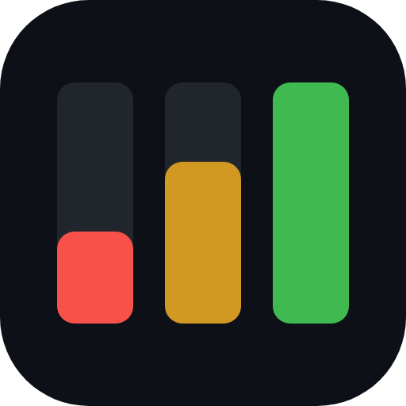

<p align="center">
  
</p>

<h1 align="center">Claude Confidence Bar</h1>

<p align="center">See how sure Claude is about what it's doing, while it's doing it.</p>

<p align="center">
  
</p>

## Install

In any terminal with the [Claude Code CLI](https://code.claude.com/docs/en/setup) installed:

```bash
claude plugin marketplace add Msapkas/claude-confidence-bar
claude plugin install confidence-meter@claude-confidence-bar
```

Then start a new Claude Code conversation. The bar appears as soon as Claude reports its first score.

## Why

When Claude works through a long, multi-step plan, it's hard to tell whether it's on solid ground or guessing. This plugin puts a small confidence bar right above your prompt so you can tell at a glance.

## How it works

Claude scores its own confidence from 0 to 100 as it works. It reports a new score:

- at the start of a plan and at each new step,
- whenever something changes its view (a test fails, an assumption breaks, the root cause turns up),
- before it finishes its turn.

It's asked to be honest about it:

| Score | Means |
| --- | --- |
| **90+** | Checked: tests pass or the behaviour has been seen working |
| **60–80** | A sensible approach that hasn't been checked yet |
| **under 50** | Guessing, blocked, or relying on unconfirmed assumptions |

## Reading the bar

| Colour | Score |
| --- | --- |
| 🟩 Green | 75 and up |
| 🟨 Yellow | 50 to 74 |
| 🟥 Red | under 50 |

- **Arrow:** whether confidence went up (↑), down (↓) or stayed about the same (→) since the last report.
- **Reason:** each score comes with one short line saying why.
- **Pop-up:** if confidence drops below 40, a short notice tells you.
- **Dimmed:** when you send a new message, the bar dims and says "(last turn)" until Claude reports again, so an old score never passes for a current one.

> The score is Claude's own estimate, not a measured probability. Treat it as a signal worth noticing, not a guarantee.

## Where it shows

A line just above the prompt, in every Claude Code app: terminal, desktop, VS Code and mobile.

## License

MIT
