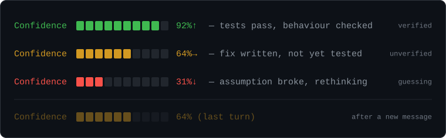

<p align="center">
  
</p>

<h1 align="center">Claude Confidence Bar</h1>

<p align="center">See how sure Claude is about what it's doing, while it's doing it.</p>

<p align="center">
  
</p>

## Install

In any terminal with the [Claude Code CLI](https://code.claude.com/docs/en/setup) installed:

```bash
claude plugin marketplace add Msapkas/claude-confidence-bar
claude plugin install confidence-meter@claude-confidence-bar
```

Then start a new Claude Code conversation. The bar is there from the start, dimmed until Claude reports its first score.

## Why

When Claude works through a long, multi-step plan, it's hard to tell whether it's on solid ground or guessing. This plugin puts a small confidence bar right above your prompt so you can tell at a glance.

## How it works

Claude scores its own confidence from 0 to 100. How often it reports depends on the mode.

## Modes

Switch with a slash command. Your choice is remembered for later sessions.

| | `/confidence-slow` (default) | `/confidence-fast` |
| --- | --- | --- |
| **Reports** | Once, at the end of a turn that did real work | When it starts, after each thinking step or finding that moves its view, and at the end |
| **Score** | Whole number, e.g. `72%` | One decimal, e.g. `72.5%`, so small shifts show |
| **Reason** | Optional | A short line every time |
| **Live thought** | No | The latest line of Claude's thinking, under the bar, refreshed every 3 seconds |
| **Token cost** | Minimal | About 5× slow |

The live thought line reads Claude's thinking as it streams, so it costs no tokens. Fast mode's extra cost comes from the more frequent reports and its longer instructions.

Either way, Claude is asked to be honest about the score:

| Score | Means |
| --- | --- |
| **90+** | Checked: tests pass or the behaviour has been seen working |
| **60–80** | A sensible approach that hasn't been checked yet |
| **under 50** | Guessing, blocked, or relying on unconfirmed assumptions |

## Reading the bar

| Colour | Score |
| --- | --- |
| 🟩 Green | 75 and up |
| 🟨 Yellow | 50 to 74 |
| 🟥 Red | under 50 |

- **Arrow:** whether confidence went up (↑), down (↓) or stayed about the same (→) since the last report.
- **Reason:** a short line saying why (always in fast mode, sometimes in slow).
- **💭 Thought:** in fast mode, a dim second line in the box with what Claude is thinking right now; the bar grows to match.
- **Pop-up:** if confidence drops below 40, a short notice tells you.
- **Dimmed:** when you send a new message, the bar dims and says "(last turn)" until Claude reports again, so an old score never passes for a current one.

> The score is Claude's own estimate, not a measured probability. Treat it as a signal worth noticing, not a guarantee.

## Where it shows

Just above the prompt, in every Claude Code app: terminal, desktop, VS Code and mobile. A vertical bar on the left fills from the bottom, with the number and arrow at its middle, joined by a short line to a thin rounded box that holds the reason (and, in fast mode, the live thought). The bar is always as tall as the box.

```
▁▁        ╭──────────────────────╮
██  72%↑─╴│ tests pass           │
██        ╰──────────────────────╯
```

If there's no room for the box, it falls back to a single line. It stays there all session; it steps aside only while Claude Code shows a feedback survey in that spot.

## License

MIT
